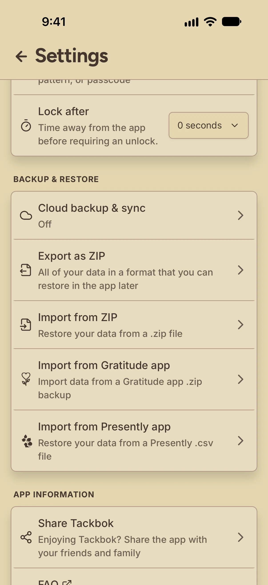
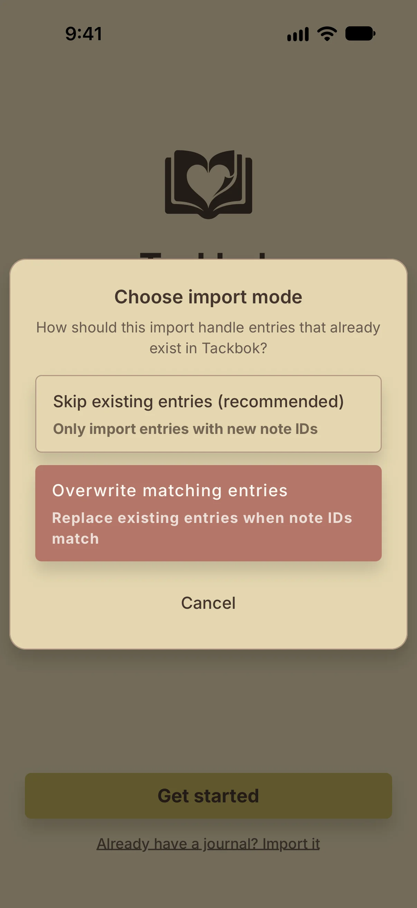

This guide is for **Gratitude: Self-Care Journal** by Hapjoy Technologies ([gratefulness.me](https://www.gratefulness.me/)), available on iPhone and Android. Several other apps have "gratitude" in their name; their export files won't work with this import.

The Gratitude app can export your journal as a ZIP file. Tackbok reads that file, including your photos and voice recordings. Your Gratitude journal stays where it is.

## What comes across

| In the Gratitude app                      | In Tackbok                                                                                           |
| ----------------------------------------- | ---------------------------------------------------------------------------------------------------- |
| Journal entry text                        | Imported as the entry text                                                                           |
| Entry date and time                       | Kept as they were                                                                                    |
| Prompt the entry answered                 | Used as the entry's title, and added to your Tackbok prompts                                         |
| Photos in an entry                        | Imported into the entry                                                                              |
| Voice recordings in an entry              | Imported as voice notes                                                                              |
| Tags                                      | Tag names are added to Tackbok, but entries aren't tagged. Re-tag entries in Tackbok if you need to. |
| Moods                                     | Not imported. Add a mood to any entry in Tackbok.                                                    |
| Name and profile photo                    | Imported into your Tackbok profile when the export has them, replacing what is there                 |
| Email                                     | Not imported. Tackbok doesn't keep an email address.                                                 |
| Affirmations, vision boards and Daily Zen | Not imported                                                                                         |
| Reminders and other settings              | Not imported. Set them up again in Tackbok.                                                          |

If an entry has no prompt, Tackbok uses the first line of its text as the title (up to 120 characters).

## Step 1: Export a ZIP file from the Gratitude app

These steps come from the Gratitude help centre article [How do I export my journal entries?](https://faqs.gratefulness.me/#/data/exporting-data):

1. In the Gratitude app, open **Settings**, then **Import & Export Data**.
2. Choose **Export as .ZIP**. Don't choose PDF: Tackbok can't read PDF files.
3. Pick the date range. To bring everything across, include all of your entries.
4. Save the file to your phone, or share it to another app.

The Gratitude app's Google Drive backup and iCloud sync are not the same as this ZIP file. Tackbok can only read the exported ZIP.

## Step 2: Get the file onto the phone with Tackbok

If you use Tackbok on the same phone, the file is already there. If not, move the ZIP file across, for example by emailing it to yourself or saving it to Google Drive, iCloud Drive or Dropbox. On iPhone, save it to the **Files** app so Tackbok can find it. Photos and recordings can make the file large, so a cloud drive often works better than email.

## Step 3: Import the file into Tackbok

[Install Tackbok](/#download) if you haven't yet, then use one of these:

**When you first open Tackbok:**

1. On the welcome screen, tap **Already have a journal? Import it**.
2. Choose **Gratitude app** and pick your ZIP file.
3. Choose **Skip existing entries (recommended)**.

**If you already use Tackbok:**

1. On the home screen, tap the **profile button** (your photo or initials) at the top right, then tap **Settings**.
2. Under **Backup & restore**, tap **Import from Gratitude app** and pick your ZIP file.
3. Choose **Skip existing entries (recommended)**.

Keep Tackbok open until the import finishes. A summary then shows how many entries, photos and voice notes were imported, and anything that was skipped.

### Which import mode to pick

Tackbok recognises entries from any earlier export of the same Gratitude journal.

- **Skip existing entries:** entries Tackbok already has from an earlier import are left alone, and only new ones are added. Use this the first time, and to add entries you wrote in the Gratitude app since your last import.
- **Overwrite matching entries:** entries Tackbok already has from an earlier import are replaced with the version in the file. Use this only to bring in edits you made in the Gratitude app. **Anything you added to those entries in Tackbok, such as moods, tags or extra photos, is removed.**

For entries that aren't in Tackbok yet, it also skips any that match an existing entry's date, time and text exactly.

## If something goes wrong

- **"Gratitude import requires a ZIP backup":** you picked a file that isn't a ZIP, such as a PDF. Export again and choose **Export as .ZIP**.
- **Some photos or recordings are missing:** the summary's **Media skipped** row counts files that were in the export but couldn't be read. Files missing from the export aren't counted. Try a fresh export from the Gratitude app.
- **The import failed:** export a fresh ZIP from the Gratitude app and try again. Make sure the file finished downloading before you pick it.

Still stuck? Email [tackbok.support@mehra.dev](mailto:tackbok.support@mehra.dev).
