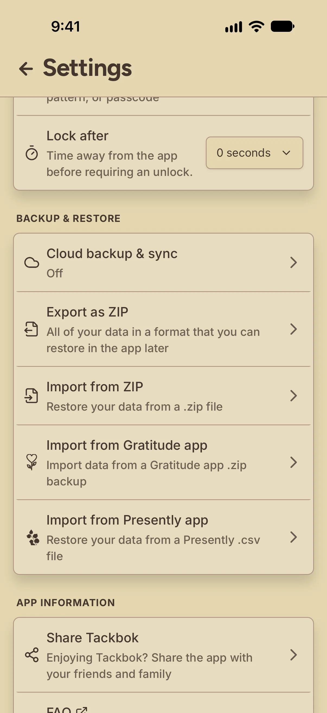

Presently is a free gratitude journal for Android. It can export your entries as a CSV file, and Tackbok can read that file. Exporting doesn't change your Presently journal.

## What comes across

Presently's export has two columns: the date of each entry and its text. Tackbok imports both.

| In Presently                                  | In Tackbok                                                                                             |
| --------------------------------------------- | ------------------------------------------------------------------------------------------------------ |
| Entry text                                    | Imported as the entry text                                                                             |
| Entry date                                    | Imported as the entry date (Presently saves only the day, so the time is set to the start of that day) |
| Reminders, theme, app lock and other settings | Not in the export. Set them up again in Tackbok.                                                       |

Presently entries don't have photos, tags or moods, so nothing else is missing. After the import you can add photos, voice notes, moods and tags to any entry in Tackbok.

Tackbok leaves out rows whose text is empty or whose date can't be read. It also skips an entry when Tackbok already has one from an earlier Presently import with the same day and exactly the same text, so importing the same file twice won't create duplicates.

## Step 1: Export your entries from Presently

These steps come from [Presently's own export guide](https://presently-app.firebaseapp.com/export.html):

1. In Presently, tap the **three dots** at the top right and open **Settings**.
2. In the **Backup & Restore** section, tap **Export entries to CSV**.
3. Save the file. Presently's guide says the file goes to your **Downloads** folder. In recent versions, Android shows a save screen so you can pick the folder yourself.

The file name starts with `PresentlyBackup` and ends in `.csv`.

**Already use Presently's Dropbox backup?** The backup file, `presently-backup.csv` in the **Apps › PresentlyBackups** folder of your Dropbox, has the same format. You can download it and import it instead.

## Step 2: Get the file onto the phone with Tackbok

- **Same Android phone:** nothing to do. The file is already on your phone.
- **New Android phone or an iPhone:** move the CSV file across, for example by emailing it to yourself or saving it to Google Drive, iCloud Drive or Dropbox. On iPhone, save it to the **Files** app so Tackbok can find it.

Presently doesn't have an iPhone app, so this file is the way to bring your Presently journal to iOS.

## Step 3: Import the file into Tackbok

[Install Tackbok](/#download) if you haven't yet, then use one of these:

**When you first open Tackbok:**

1. On the welcome screen, tap **Already have a journal? Import it**.
2. Choose **Presently app**.
3. Pick your Presently CSV file.

**If you already use Tackbok:**

1. On the home screen, tap the **profile button** (your photo or initials) at the top right, then tap **Settings**.
2. Under **Backup & restore**, tap **Import from Presently app**, then **Import**.
3. Pick your Presently CSV file.

Keep Tackbok open until the import finishes. A summary then shows how many new entries were imported, and how many were skipped as duplicates.

## If something goes wrong

- **"Invalid CSV format: missing entryDate or entryContent columns":** the file isn't a Presently export, or it was changed. If you opened it in a spreadsheet app and saved it again, export a fresh copy from Presently and import that instead.
- **"CSV file is empty or has no data rows":** the file has no entries. Check that you picked the right file.
- **Fewer entries than you expected:** entries Tackbok already has are counted under **Skipped duplicates**, which is normal after a second import. Rows with empty text or an unreadable date are left out and aren't counted.

Still stuck? Email [tackbok.support@mehra.dev](mailto:tackbok.support@mehra.dev).
